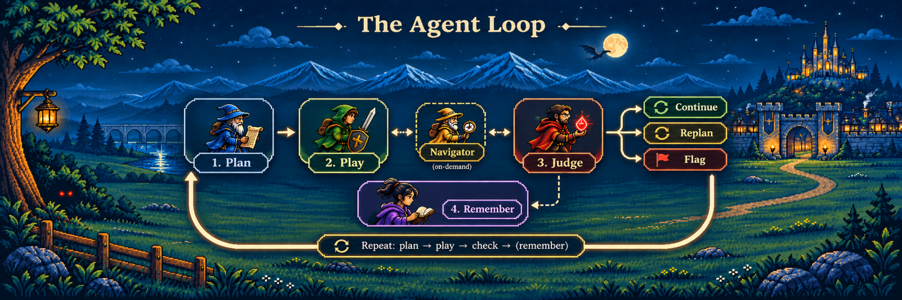
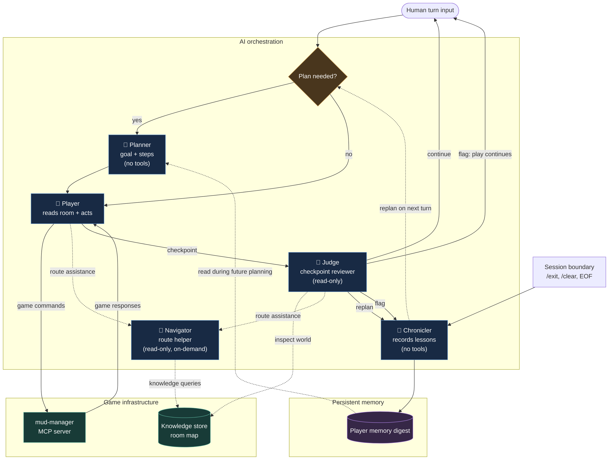

<div align="center">
  
</div>

# Boukensha — an AI that learns to play a text adventure game

## What is this project?

A MUD ("Multi-User Dungeon") is an old-school, text-only online game. You type commands such as `look`, `north`, or `attack goblin`, and the game responds with descriptions of what happened.

**Boukensha** is an AI agent that reads those responses, decides what to do, and sends commands back to the game. Rather than being given every move, it uses specialised AI roles to plan objectives, play, check progress, navigate a growing map, and remember what it learns across sessions.

The project was built incrementally during the coding camp and tested against a real CircleMUD server. Its current interface is a REPL: a human still supplies turn input, while the AI chooses and executes game commands. A fully autonomous outer session loop remains future work.

> In two live sessions costing **$0.10 combined**, the Judge identified a reason to **replan**, and lessons saved from the first session informed planning in the second. The run is documented in [the Week 3 engineering journal](docs/journal/3_capable.md). These runs verify the planning, judging, and memory mechanisms—not that they outperform a single-agent baseline. The Navigator was available but not called in these sessions.

## The journey, week by week

| Week | What was added |
|---|---|
| **Week 0 — Explore** | Connected to the text game and learned to send and receive commands. |
| **Week 1 — Baseline** | Built the first working read → decide → act agent. |
| **Week 2 — Observability** | Added a persistent room map, tracing, and a dashboard to inspect the agent's decisions. |
| **Week 3 — Capable** *(current)* | Added planning, checkpoints, navigation assistance, and memory across sessions. |

## How Boukensha thinks

One adventurer, five specialised AI roles. Four form the core process; the fifth, Navigator, helps when directions are needed.



**Plan → Play → Check → Remember.** The Judge decides whether to continue, replan, or flag an issue. Navigator can help the Player or Judge with routes on demand; Chronicler records lessons on a replan, flag, or session boundary. Those lessons can inform the next plan.

This is a **simplified process**, not a fixed sequence on every turn: checks happen at configured checkpoints, navigation is optional, and memory is written conditionally. Each role makes a separate AI model call with restricted permissions. See the [Week 3 technical write-up](week3_capable/README.md) for details.

## Architecture, for a closer look

The illustration above shows how Boukensha thinks. This diagram shows how the
system actually works: how the five AI roles interact, which components can
access the game, and how knowledge and memory are managed.



### Key architectural decisions

- **Five specialised AI roles.** Planner, Player, Judge, Navigator, and Chronicler are independently configured model calls, each with a specific responsibility.
- **Permission boundaries.** Only the Player performs game actions. Judge and Navigator have read-only tools, while Planner and Chronicler have no game-action tools.
- **Shared world knowledge.** The Judge and Navigator query the same in-process room map. The Player receives its current room information directly, avoiding redundant lookups.
- **Persistent learning.** The Chronicler records lessons on `replan`, `flag`, or session boundaries. Saved memory informs future planning rather than being injected directly into every Player turn.

The diagram shows the main control flow rather than every internal operation.
Judge checkpoints are periodic, Navigator is consulted only when needed,
and a `flag` does not automatically stop the game.

For implementation details, permission enforcement, session compaction,
and technical trade-offs, see the
[Week 3 technical documentation](week3_capable/README.md).


## Want to go deeper?

| Path | What's there |
|---|---|
| [`week0_explore/`](week0_explore/CHALLENGES.md) | The first step — talking to the game over a raw connection |
| [`week1_baseline/`](week1_baseline) | The first working agent, built one lesson at a time |
| [`week2_observability/README.md`](week2_observability/README.md) | The world map, dashboard, and tracing |
| [`week3_capable/README.md`](week3_capable/README.md) | Technical details of the five specialised roles |
| [`docs/plans/capability/`](docs/plans/capability) | Design documents written before Week 3 was built |
| [`docs/journal/3_capable.md`](docs/journal/3_capable.md) | Engineering journal: tests, surprises, and open questions |

## Setup

Run these commands from a **clone of the repository** unless a step says otherwise. This project is a development/camp build, not a one-command hosted service.

### 1. Prerequisites and game server

You'll need **Ruby 3.0+**, RubyGems, an AI provider API key (Anthropic is the example below), and **Docker with Compose** to run the included CircleMUD server. Bundler is also needed for the dashboard and test commands. The terminal UI is optional; on Windows, use `boukensha --no-tui` if its `charm` dependencies are unavailable.

```sh
cd week0_explore/infrastructure
docker compose up --build -d
cd ../..
```

This starts CircleMUD at `localhost:4000`. Before running Boukensha, create or verify a game character on that server and set its **actual username and password** under `mcp_servers.mud.env` in `.boukensha/settings.yaml`. The example `dummy` / `helloworld` credentials below are **not guaranteed to exist** on a fresh server. See [CircleMUD infrastructure](week0_explore/infrastructure/README.md).

### 2. Build and install the gems

`boukensha` launches `mud-manager` by command name, so both installed executables must be on `PATH`. The repository's rebuild script builds and installs the Week 3 versions in the correct order:

```sh
ruby week3_capable/bin/rebuild
```

Alternatively, build and install `week3_capable/mud_manager` followed by `week3_capable/boukensha` manually. If your shell cannot find `mud-manager` or `boukensha`, check the RubyGems executable directory on `PATH`.

### 3. Point `boukensha` at this repo's config

By default `boukensha` looks for its config in `~/.boukensha`, not the
repo. Point it at the repo-root `.boukensha/` instead — either per shell
session:

```sh
# Bash / zsh, from the repository root
export BOUKENSHA_DIR="$(pwd)/.boukensha"
```

On **PowerShell**, from the repository root:

```powershell
$env:BOUKENSHA_DIR = (Join-Path (Get-Location) '.boukensha')
```

or once, in `~/.boukensharc`:

```yaml
boukensha_dir: /absolute/path/to/this/repo/.boukensha
```

The configuration lives in `.boukensha/settings.yaml` (shared across weeks). **The following is an illustrative excerpt, not the entire committed file:**

```yaml
tasks:
  player:
    provider: anthropic
    model:    claude-haiku-4-5
    prompt_override:
      system: true

mcp_servers:
  mud:
    command: mud-manager
    args:    [--mcp]
    prefix:  tbamud
    env:
      MUD_HOST:     localhost
      MUD_PORT:     "4000"
      MUD_NAME:     dummy
      MUD_PASSWORD: helloworld
```

Connection credentials are passed to `mud-manager` through the MCP server environment, not as model tool arguments. Replace the sample login values with your own. The committed configuration also includes logging and OpenTelemetry options: review those before running; the exporter expects a compatible local collector when tracing is enabled.

### 4. `.boukensha/.env` (repo root, git-ignored)

```sh
ANTHROPIC_API_KEY=sk-ant-...
OPENAI_API_KEY=sk-...
GEMINI_API_KEY=...
OLLAMA_API_KEY=...
```

Only define the key(s) for the provider(s) you use. Never commit this file or real credentials.

### 5. Run

```sh
boukensha              # TUI REPL
boukensha --no-tui     # plain-terminal REPL
```

The character played is whichever `MUD_NAME` is set in
`mcp_servers.mud.env` above.

### 6. Optional: the dashboard

```sh
cd week3_capable/mud_monitor
bundle install
bundle exec ruby bin/mud_monitor   # http://localhost:4568
```

### 7. Optional: turn on Plan / Check / Remember

These optional capabilities are off unless explicitly enabled. Add the relevant blocks to your existing `tasks:` section, rather than replacing your entire settings file:

```yaml
tasks:
  planner:
    provider: anthropic
    model:    claude-haiku-4-5
    enabled:  true
  judge:
    provider: anthropic
    model:    claude-haiku-4-5
    enabled:  true
    every:    3        # check in every 3rd turn
  chronicler:
    provider: anthropic
    model:    claude-haiku-4-5   # required whenever memory is on — Remember
                                  # has no `enabled:` flag of its own, but
                                  # still needs a model to call

memory:
  enabled: true
```

See [`week3_capable/README.md`](week3_capable/README.md) for the full set of
options, including the Navigator.

### 8. Tests

```sh
(cd week3_capable/boukensha   && bundle exec rake test)
(cd week3_capable/mud_manager && bundle exec rake test)
(cd week3_capable/mud_monitor && bundle exec rake test)
```

## Current status and next steps

**Built and tested:** game interaction, a persistent room map and observability tools, specialised planning and judging roles, an optional read-only Navigator, and cross-session memory. Two live sessions demonstrated a real `replan` verdict and memory carried into a subsequent plan.

**Still to investigate:** a fully autonomous session-driving loop, whether orchestration improves outcomes over the Week 2 baseline, how often Navigator proves useful in live play, and how well memory retains important lessons over longer runs. The [engineering journal](docs/journal/3_capable.md) records the evidence and limitations.
